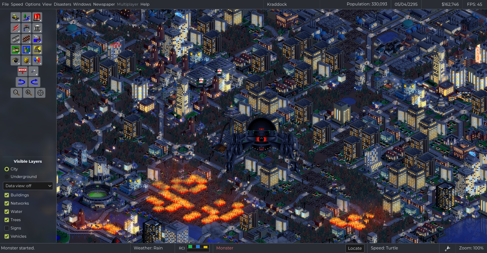
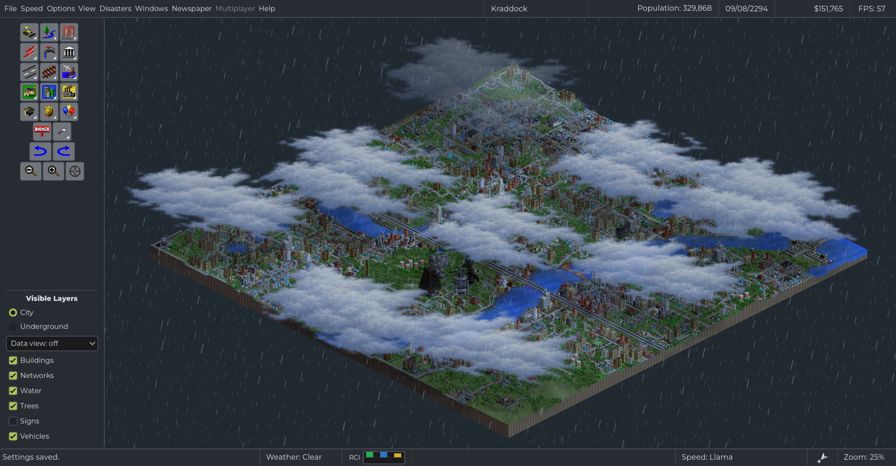
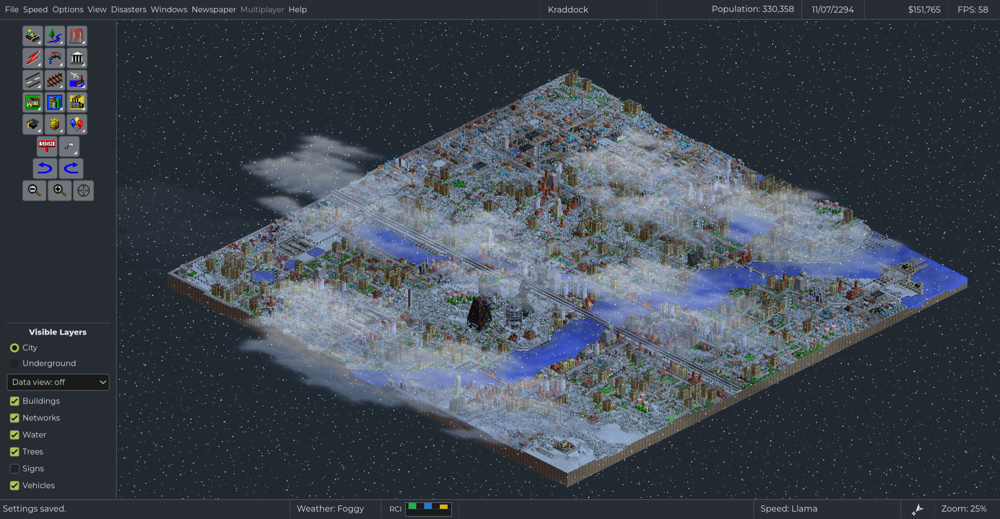
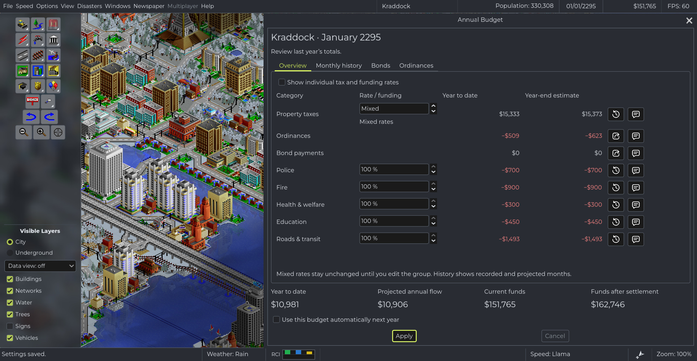
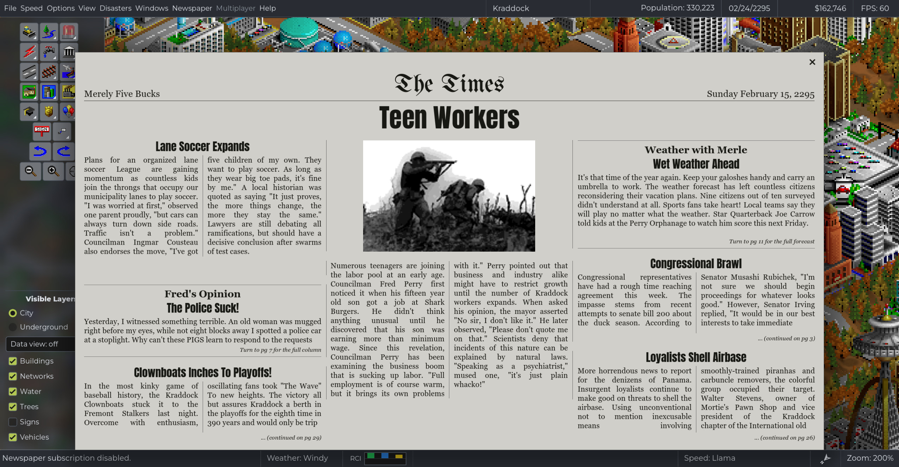
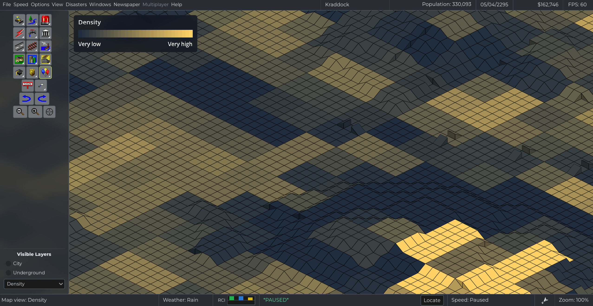

# Reticulating Splines

**SimCity 2000, reimagined. Rediscover the city you remember—with new possibilities.**

[Website](https://rs.realm667.com/) · [Gallery](https://rs.realm667.com/#screenshots) · [FAQ](https://rs.realm667.com/#faq) · [Support the project](https://rs.realm667.com/#support)

Reticulating Splines is developed by **Daniel Gimmer (Realm667)** as an enhanced fork of
[OpenSC2K](https://github.com/nicholas-ochoa/OpenSC2K), Nicholas Ochoa's independently
written, open-source reimplementation of SimCity 2000 using Rust and Godot.
Enjoy familiar graphics, music and sounds with new lighting, weather, modern
tools and experimental multiplayer in an OpenSC2K-based engine.

- **Bring your original game.** Import assets from your own supported SimCity 2000
  copy and use them with the project's enhancements. Original game files are not included.
- **No original copy? No problem.** Optional Reticulating Splines graphics, music
  and sound packs provide an alternative without original assets or previous
  SimCity experience. Both approaches use the same engine and feature set.
- **Prefer the classic presentation?** Leave optional visual enhancements and
  mods off, and play with your imported original artwork and audio. Enable the
  additions you want when you are ready.

Visual enhancements change presentation without changing the underlying
single-player simulation rules. Multiplayer adds its own shared-control,
ownership and municipal-account rules. Reticulating Splines does not patch or
run the original SimCity 2000 executable.

**Development status:** the project is in development; multiplayer is experimental.
The OpenSC2K base supports Windows, macOS and Linux. Reticulating Splines downloads,
confirmed requirements and installation instructions will be announced with its
release. For now, see [building from source](#run-reticulating-splines).

The default branch, **`reticulating-splines`**, is the shared development source.
Upstream changes are reviewed manually before integration. The retained `main`
and older feature branches are historical references. Existing OpenSC2K user
profiles remain compatible; Windows exports use **`ReticulatingSplines.exe`**.

## Included features

| Area | What you can explore |
| --- | --- |
| Building & planning | Eleven map sizes from 16 to 4096 tiles per side, including classic 128 × 128 cities; configurable terrain, per-tile data maps, service coverage, transport overlays and additional zoom levels. Large maps need more memory and preparation time. |
| Light, weather & life | Day/night cycles, illuminated windows and streets, rain, snow, storms, clouds, fog, seasons, reflective water, waves, forests, decorative traffic and pedestrians. |
| Multiplayer | Two to eight players over LAN or direct IP, with Co-op, Competitive Shared and Competitive Region modes. |
| Everyday comfort | Middle-click tool picking, remembered window positions, compact tool flyouts and light/dark interface themes. |
| Music & sound | Imported original audio, optional replacement packs or your own MP3 folders, with favorites and playback-queue controls in the music box. |
| Artwork & modding | Original or replacement artwork, separately selectable asset packs and JavaScript mods with game events, an API and a developer console. |
| Languages | English, German, Spanish, French, Italian, Brazilian Portuguese and Korean; Korean coverage is still being expanded. |
| Classic presentation | Optional visual effects and mods can remain off while you enjoy the original artwork and soundtrack. |

The [package library](docs/package-library.md) manages separate graphics, sound,
music, brightmap, HD sprite, city and mod sources. Original assets can be imported
without activation, or imported and activated. Failed source changes retain the
previous source. See [quality-of-life improvements](docs/quality-of-life.md),
[scripting](docs/scripting.md) and [mods](docs/mods.md) for details.

City selection and loading show bounded previews; manual single-player saves
retain a verified `.bak` predecessor. Long tooltips wrap to a readable width.
Large terrain previews run in the background with progress feedback.

### Visual enhancement controls

Open **Settings > Visual Enhancements**. The settings are grouped as follows:

| Section | Controls and effects |
| --- | --- |
| Day & Night | A day/night cycle or a fixed time, ambient color and night strength. |
| Lighting | Building and vehicle brightmaps, street and highway lights, ground illumination, glow, a daytime override and a minimum zoom for detail lights. |
| Seasons | City-calendar seasons, an independent visual cycle or a fixed season, with adjustable color and transition strength. |
| Weather & Clouds | Game weather, visual automation or fixed rain, snow and thunderstorms; separate cloud and fog controls, cloud shadows and coverage. Storms include ambient wind, rain and thunder audio; dry thunderstorms omit rain. |
| Environment | Connected forests, tree variants, terrain-aware tree shadows, subtle ground variation, water reflections, underwater terrain, waves, coastal surf and seasonal water color. |
| Traffic & Movement | Decorative individual cars and pedestrians, smoother existing vehicles and transparent aircraft shadows. |
| Disaster Effects | Extra fire and impact light, dust, crowds, tornado motion and earthquake shake. Volcanic clouds use warm colors; pollution and toxic effects use green. |
| Animation | Transition blending, linkage to game speed and pause behavior for environment cycles. |
| Tilt Shift | Adjustable blur at the map edges with a sharp center and interface; enabled at a subtle strength by default. |
| Custom Graphics | Optional color LUT and brightmap overrides. Standard effects use the included resources. |

The scrolling city in the main menu also uses the visual settings. Each launch
starts its preview with a randomized time, season and weather, without replacing
the user's stored choices for a playable city.

**Follow game speed** uses 1×, 1.5×, 2× and 3× presentation time at Turtle,
Llama, Cheetah and African Swallow. Decorative cars and pedestrians, artwork,
palette cycles and enhanced fire animation use this shared scale. Fades retain
their readable duration. Simulated ships, trains and aircraft keep their original
routes and movement timing.

Only the host writes the normal SC2X save. Session data is embedded automatically;
the prior save remains as `.bak`. Keep each participant's private data profile to
reconnect as the same player. Only the host controls simulation speed and pause;
client dialogs and disconnections do not stop the match. Conflicting edits are
rejected without payment. A normal host shutdown offers clients a single-player
copy. Saved multiplayer games can also be opened explicitly as single-player copies.

## Try the effects

1. Load an existing city, or finish terrain editing and **found a new city**.
   The terrain editor does not show the full playable-city weather environment.
2. Open **Settings > Visual Enhancements** and enable the relevant sections.
   Weather and clouds have separate switches; fog belongs to Clouds.
3. For a reproducible night view, choose a fixed time in **Day & Night** and enable
   **Lights and brightmaps** in **Lighting**. Adjust ambient light, glow and ground
   lighting independently.
4. For a seasonal or weather preview, choose **Fixed season** or **Fixed weather**.
   Fixed snow can be displayed in any season. These controls do not rewrite the
   simulation's weather or calendar.
5. Use the category reset and Undo controls to compare settings. Weather and
   cloud animation pause with the game; other environment cycles use the pause
   and speed options in **Animation**.

Standard brightmaps are included in
[game/assets/brightmaps/standard](game/assets/brightmaps/standard).
Leave the custom graphics paths empty to use the built-in resources. The custom
brightmap folder is an override, not a required external download.
Building brightmaps follow the city's power state: unpowered buildings do not
emit window light. This reads existing power information without changing supply.

## Rendering and performance

Lighting placement follows city geometry, including diagonal routes and slopes.
Static visual layers are cached, and prepared graphics-size variants can be
retained across zoom changes. Loading a city or invalidating affected geometry
can still require visual preparation; caching does not make every effect free.

**Detail lights from zoom** deliberately hides fine lighting below the selected
zoom level (50% by default). Lower that threshold to show detail lights farther
out. For less rendering work, reduce cloud coverage, decorative traffic or
lighting effects. Performance depends on city size, viewport and enabled effects;
this branch does not promise a fixed frame rate.

## Scope and compatibility

Preferences are local presentation settings, not changes to city documents.
The package includes the water-surface/depth work and its related rendering fixes.
The shared branch includes [localization](docs/localization-sources.md)
and [multiplayer](docs/multiplayer.md); separate historical feature branches are
retained in [this fork](https://github.com/Realm667/Reticulating-Splines).
The underlying upstream SC2/SC2X compatibility rules still apply.

## Multiplayer

Experimental multiplayer supports **two to eight players over LAN or direct IP**.
All participants need the same network build.

| Mode | How you play |
| --- | --- |
| Co-op | Build one city together with a shared treasury and shared decisions. |
| Competitive Shared | Develop separate territories, budgets and services on the same map. |
| Competitive Region | Run separate cities and make read-only visits to your neighbors. |

Competitive Shared includes land offers, counteroffers and player loans.
Competitions can be open-ended or use population or net-wealth targets with a
required time in the lead. In-game chat, named player cursors, standings and
rematches help you coordinate or compete. Save a match, reconnect, or open a
supported multiplayer save as a single-player copy.

See the [multiplayer guide](docs/multiplayer.md) for setup, mode-specific rules,
save behavior and current limitations.

## Localization & languages

Choose **Settings > General > Language** to select English, German, Spanish,
French, Italian, Brazilian Portuguese or Korean. Language selection does not
require a separate language-specific asset pack or conversion of your cities.
User-written city names and signs remain as entered.

Where available, wording from original localized SimCity 2000 editions preserves
familiar terminology, adviser messages, newspaper text and scenario descriptions.
AI-assisted supplementary translations cover new features and missing text,
including visual enhancements, multiplayer and quality-of-life additions.
Korean still has legacy base-game gaps; coverage does not imply complete
native-speaker editorial review.

See [translation sources and coverage](docs/localization-sources.md) and the
[central translation workflow](game/assets/localization/README.md).

## Import SimCity 2000

Use your own supported copy to import graphics, sounds, music and game data.
**Windows 95 Special Edition (1996), using a complete installation, is recommended
for the most complete import.**

| Original edition | Import coverage |
| --- | --- |
| Windows 95, including the 1996 Special Edition | Supported; a complete installation supplies the fullest set of resources. |
| Windows 3.x | Supported. |
| Windows Network Edition | Supported. |
| DOS | Supported. |
| Classic Macintosh | Supported with edition-specific limitations. |
| Demos | Partial content, depending on the files provided. |

1. **Prepare your files.** Install a GOG copy first, extract archived files, or
   mount a disc image. Select the installed files, not the installer or ISO itself.
2. **Choose your source.** Open **Settings > Import Data > Import SimCity 2000**
   and select an installed folder, extracted files, a macOS `.app` package or a
   mounted game CD. For a multi-edition disc, choose its specific edition folder.
3. **Import your assets.** Choose Graphics, Sounds, Music and/or Game data, then
   select Import. Review the result for missing or partially imported resources.

Some interface graphics and SCURK resources require a complete Windows
installation. Macintosh scenarios whose objectives are stored in resource forks
are not copied; the 1993 Macintosh demo's newspaper grammar is not imported.
Amiga and console editions are not supported import sources.

**Your source files stay untouched.** The importer reads them without running or
modifying them. These are supported *data sources*, not a list of old operating
systems on which Reticulating Splines runs. Original assets are not included with
the project. Without them, use the available Reticulating Splines replacement packs.

See [the import documentation](docs/media-pack-format.md#import-original-game-files)
for detailed source requirements and limitations.

## Screenshots

Current in-game captures from the [website gallery](https://rs.realm667.com/#screenshots),
showing imported SimCity 2000 artwork with Reticulating Splines enhancements.
Click an image to open the full-resolution screenshot.

**Night lighting and a monster disaster in Kraddock**

[](.github/screenshots/website/kraddock-night-disaster.jpg)

**Rain and cloud layers over the city**

[](.github/screenshots/website/kraddock-rain-clouds.jpg)

**Snowfall and winter scenery**

[](.github/screenshots/website/kraddock-snow.jpg)

**Annual budget in the dark interface**

[](.github/screenshots/website/annual-budget.jpg)

**The classic city newspaper**

[](.github/screenshots/website/city-newspaper.jpg)

**Isometric density view**

[](.github/screenshots/website/density-view.jpg)

## Run Reticulating Splines

Build this branch from source, or use a package explicitly built from it. The
[upstream releases](https://github.com/nicholas-ochoa/OpenSC2K/releases) are the
base game; they do not include this fork's branch-specific additions.

Use **Godot 4.7**, Python 3, and Rust installed through [rustup](https://rustup.rs).
The repository's `rust-toolchain.toml` selects the Rust version. Native audio also
requires CMake. See [installation](docs/install.md) and
[native build details](docs/native-simulation.md) for platform requirements.

```sh
git clone --branch reticulating-splines --single-branch https://github.com/Realm667/Reticulating-Splines.git Reticulating-Splines
cd Reticulating-Splines
python3 tools/build_native.py
godot --headless --audio-driver Dummy --path game --editor --import
godot --path game
```

On Windows, use `python` if that is the name of your Python executable, and the
path to your Godot executable if `godot` is not on PATH. Wait for the native build
and resource import to finish before starting the game. Opening
`game/project.godot` in the Godot editor also imports resources.

For original graphics, sound, music and data, follow [Import SimCity 2000](#import-simcity-2000).
The optional replacement packs are separate sources; original game data is not
included in the source checkout.

## Upstream project

Based on [nicholas-ochoa/OpenSC2K](https://github.com/nicholas-ochoa/OpenSC2K).
Join the upstream [Discord community](https://discord.gg/k9S6c3AqcX).

## Base-game features

- Larger cities: 256, 384, 512, 640, 1024, 2048 and 4096 tiles per side, alongside the original 128; larger maps need more memory and preparation time
- Smaller cities: 16, 32 and 64 tiles per side
- Updated coverage, land value, pollution, crime, and other data maps to be 1:1 resolution with the map, instead of lower resolution
- Massively increased the amount of MicroSims (XMIC) and movable objects (XTHG) that are available to be used in each city
- Improved terrain generator with configurable terrain features supported
- New isometric data views, height map, service coverage, and transport-trip overlays
- More zoom levels, layer controls, and optional dark underground views
- Detailed simulation data available including simulation timings, inspection tools
- Support for external graphics, sound, and music packs
- A JavaScript runtime for mods and developer scripts, with game events, a game API, example mods in `examples/mods`, and a Chrome DevTools console. Mods load from the `mods` folder, each in its own sandbox, and the Mods tab of Settings turns them on and off. See [Scripting](docs/scripting.md) and [Mods](docs/mods.md)

Larger cities and per-tile data maps use `.sc2x` saves: ZIP archives with one raw entry per
city structure, city names of up to 64 characters, and signs that can share a tile with any
building. See [the SC2X format](docs/sc2x-format.md). The original game cannot open these
files. Original `.sc2` cities keep their separate compatibility mode until you choose
**Upgrade City to SC2X**. Older `.sc2x` files load as version 4 cities and save as a new copy.

<a id="sc2kfix"></a>

## Classic fixes

Reticulating Splines inherits selected improvements identified by
[sc2kfix](https://github.com/sc2kfix/sc2kfix) and adopted or reimplemented by
OpenSC2K. Credit belongs to the sc2kfix contributors and the OpenSC2K team;
this is **not an integration of the complete sc2kfix plugin**.

- **Clearer finances:** corrected city-value calculations and daily updates,
  with bond eligibility using the same credit-rating scale as the budget and advisors.
- **Smoother classic behavior:** more reliable military-base placement, stadium
  teams released after demolition and power-saving advice only when a power plant exists.
- **Graphics and city care:** improved SCURK handling, clearer scenario progress,
  terrain/sign repair tools and support for the sc2kfix save format for 128 × 128 cities.
- **14 optional sprite corrections:** original-sprite placement, clipped edges,
  DOS/Macintosh color animations and the Hangar 1 door. These apply only to matching
  original Windows sprites, not SCURK graphics sets, HD/TrueColor packs or the
  Reticulating Splines graphics pack.

The sc2kfix `.sc2x` format is distinct from OpenSC2K's extended SC2X format; the
shared extension does not make them interchangeable. See [SC2X formats](docs/sc2x-format.md).
The [sc2kfix MIT notice](LICENSE) is retained for adapted work.

## Development

Open `game/project.godot` in Godot. Run `python3 tools/build_native.py` after each change
to a crate in `native`. It also builds the FluidSynth library, which needs CMake. The validation command also builds the native libraries and runs
their unit tests. See [the native simulation](docs/native-simulation.md),
[the native region builder](docs/native-rendering.md),
[the native formats](docs/native-formats.md), [the native audio](docs/native-audio.md),
[FluidSynth music](docs/fluidsynth.md) and [the native scripting](docs/native-scripting.md) for their layouts. Run the checks with:

```sh
tools/validate_project.sh
```

The tests use silent audio. Generated city fixtures are committed and checked by
[the fixture test](game/tests/generated_city_fixtures_test.gd). Original-data audits
need `references/SIMCITY2000`; renderer and media tests can also need imported packs
in `ext/`. See [the golden corpus](docs/golden-corpus.md) and
[CI and local validation](docs/ci.md).

<a id="ai-assisted-development"></a>

## The person behind the project

Reticulating Splines is a personal project developed and maintained by
**Daniel Gimmer (Realm667)**, based on **OpenSC2K by Nicholas Ochoa**. Daniel is a
SimCity 2000 enthusiast with a vision for familiar cities, richer atmosphere and
new ways to play together. **OpenAI Codex Astra** has assisted Daniel with
development of the fork's additions, research, documentation, testing and
debugging. Daniel remains responsible for the project's direction, review and testing.

Heartfelt thanks go to **Nicholas Ochoa and the OpenSC2K contributors** for their
outstanding work. Without that foundation, Reticulating Splines would not be possible.
See [AI-POLICY.md](AI-POLICY.md) for the project's AI usage and contribution policy.

## Support the project

Daniel has already invested several thousand euros of his own money and countless
hours into planning, testing and refining Reticulating Splines. AI-assisted
development makes the project possible, but it comes with substantial costs.

If you enjoy the project or want to help it grow, a voluntary donation helps cover
those costs and supports continued work on features, fixes and details.
Any amount is appreciated—thank you for helping build the next chapter.

**[Support Realm667 via PayPal](https://www.paypal.com/donate?hosted_button_id=MCGC2LCJ5FHN6)**
or read more [on the website](https://rs.realm667.com/#support).

## License

Project code is under the [MIT license](LICENSE).

Bundled fonts, including [Montserrat](game/assets/fonts/montserrat/OFL.txt) and
[Rajdhani](game/assets/fonts/rajdhani/OFL.txt), retain their own licenses. See
[third-party notices](THIRD_PARTY_NOTICES.md).

The MIT license does not grant rights to the original game or its assets.

This project is not affiliated with or endorsed by Maxis or Electronic Arts.

OpenSC2K is an independently written re-implementation. Compatibility and simulation behavior
have been determined through observation, testing, analysis of game data, publicly available
research, and reverse engineering of the original executable.

Original SimCity 2000 source code and imported game assets are not distributed
with Reticulating Splines. Replacement packs retain their own notices and provenance.
